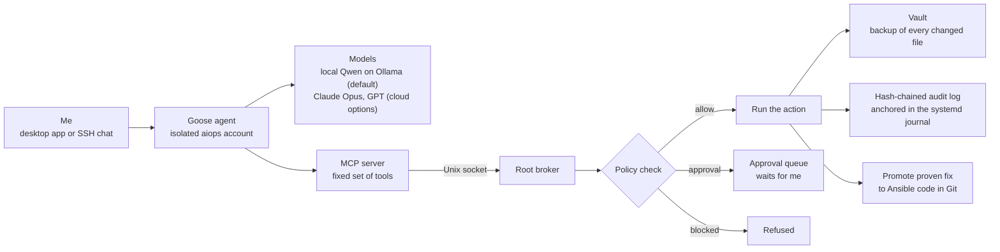

# AI Ops Agent: a self-hosted Linux troubleshooting agent

**Sep 2026 to present · Python, MCP, Ollama, Goose, Ansible, systemd, nftables, SELinux**

An AI agent that investigates and fixes problems on my Fedora Linux workstation without supervision. Every action it takes is policy-checked, backed up, logged in a tamper-evident audit trail, and reversible.

## The problem

AI agents are useful for troubleshooting, but giving one root access is risky. It can break the boot loader, leak credentials or change things nobody can trace. I wanted an agent I could hand a vague problem ("games microstutter, investigate and fix what you safely can") and walk away from, knowing it could not do lasting damage.

## Architecture

The agent never runs commands directly. It calls tools on an MCP server. The server forwards each request over a Unix socket to a root broker, and the broker decides whether the request runs.

## Key design decisions

- **Three policy tiers.** Diagnostics, edits under `/etc` and my home folder, service restarts and ordinary packages run automatically. The boot loader, kernel arguments, GPU drivers, `/etc/fstab` and core packages wait in an approval queue for me. Credentials, network shares, other LAN devices and the agent's own configuration and logs are blocked outright.
- **Everything is reversible.** Deletes become moves into a vault. Every change records its before and after state and an undo recipe, so I can revert a single change or a whole case with one command. Before an approved risky change, the broker takes a read-only filesystem snapshot.
- **A tamper-evident audit trail.** Each event stores the hash of the event before it, so editing or deleting any past event breaks the chain. Each new hash is also copied to the systemd journal as an independent record. A verify command checks the whole chain. [Code excerpt](../samples/audit_chain.py).
- **System actions come from a fixed catalog.** Kernel arguments, firewall ports, SELinux booleans, version locks and similar actions are predefined entries. Each one validates its arguments, has a tier, records state and knows how to undo itself. Adding a capability means adding one catalog entry and a test.
- **Safe web research.** The agent can search the web through a private SearXNG instance and fetch pages. Both run in a sandbox with internet access but no LAN access, and the results are marked untrusted.
- **Local first, cloud when needed.** A local Qwen model on Ollama is the free default. Claude Opus or GPT can be chosen per chat for harder problems.

## From fix to code

When a fix is proven, a promote command reviews which changes are still in effect. It writes them as Ansible tasks on a new branch and runs `ansible --check`, which must report zero changes before I merge. Because the whole workstation is already defined in Ansible and chezmoi, every verified fix becomes part of a machine I can rebuild from Git.

Seven cases have been promoted so far. One was a suspend-resume failure that left PCIe devices inaccessible and dropped the USB and SATA controllers. Another set up Linux support for a USB audio DAC whose vendor software is Windows-only.
