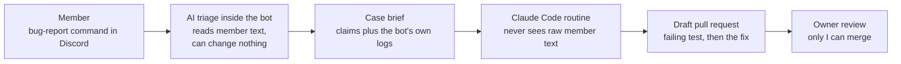

# AI Discord bots

**Mar 2023 to present · Python, discord.py, Anthropic and OpenAI APIs, Claude Code, pytest, GitHub Actions, systemd**

Two Python bots that I built and run for a community of about 1,500 members. They are my longest-running production software: real users, real data and real outages to plan for.

- **A dice game bot** runs a multiplayer bluffing dice game with Elo rankings, seasons and leaderboards, used across several Discord servers. I hand-coded it from Mar 2023 (440+ commits) before overhauling it with Claude Code.
- **An AI assistant bot**, running since Jul 2024, handles chat replies, translation, summaries and moderation. It includes an AI player that joins the dice game against members and writes a post-game analysis.

## Multi-provider AI with failover

Every model call goes through one shared client. That client keeps connections open, retries with backoff, and logs the purpose, model, tokens and time of every call, but never the prompt or the reply. When a Claude call fails after its retries, because of an outage, an overload, a rate limit or a time-out, the same request goes to an OpenAI model instead, and the reverse also works. A model that declines a request counts as an answer, not a failure, so a refusal never moves the call to the other provider. [Code excerpt](../samples/model_fallback.py).

## An AI bug-report pipeline with prompt-injection walls

Members report bugs with a slash command. An AI triage step inside the bot reads the reports and writes a case brief with the bot's own log lines. A Claude Code routine then reproduces the bug, writes a failing test, makes the smallest fix and opens a draft pull request.

The design rests on two walls. The AI that reads member text can't change anything, and the AI that changes code never reads member text. Owner instructions in the brief are fenced with a random code that member text can't forge. The fixer can never merge, push to `main` or touch protected files, and I review every change.

## Self-hosted, with automatic rollback

The bots run on my VMware ESXi homelab, on an AlmaLinux VM under systemd with sandboxing rules. A deployer I built checks GitHub every minute and pulls new merges with read-only deploy keys. GitHub never connects to the server.

- If `requirements.txt` changed, the deployer builds a new Python environment beside the old one and switches only when the install succeeds.
- If the bot isn't running 50 seconds after a restart, it restores the previous commit and environment and alerts me.
- It never overwrites hand edits or deletes data files, and it waits for running games to finish before updating the dice game bot.
- If a bot stops on a broken data file, the deployer tells a code fault from a data fault by trying the previous commit.
