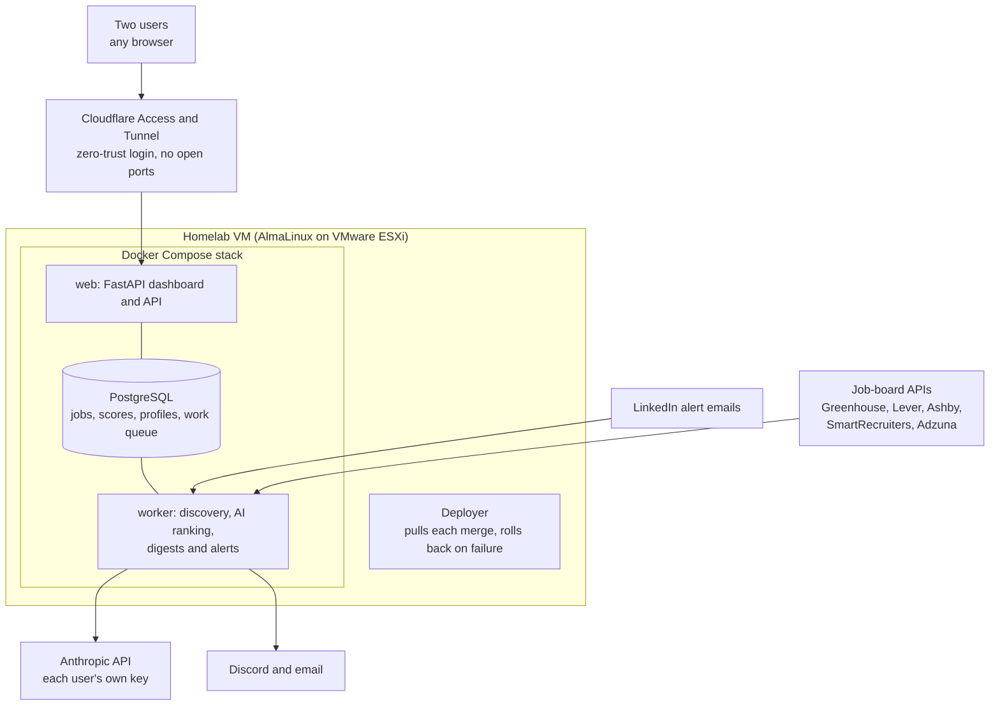

# JobScout: an AI job-matching app

**Oct 2026 to present (in progress) · Python, FastAPI, PostgreSQL, SQLAlchemy, Alembic, Docker Compose, Anthropic API, Cloudflare, GitHub Actions**

A private job-search assistant for two people. It collects job postings, ranks every one against each person's profile and resumes with AI, explains each score in plain English, and sends a ranked digest to a web dashboard, Discord and email.

## The problem

Job boards return thousands of loosely matched postings, and their keyword filters miss good roles while surfacing bad ones. I wanted a tool that catches nearly every fitting job, explains why each one fits or doesn't, and costs each person about $10 a month or less in AI usage.

## Architecture

## How ranking works

1. **Rules first.** Hard filters on location, seniority and dealbreakers remove clear mismatches for free.
2. **A quick screen with Claude Haiku**, at about $0.0004 a job. It returns a 0 to 100 score and a one-line reason. It also works out the remote, hybrid or on-site status and the real seniority level from the posting text, because job boards often state these wrong. A job with no description gets a labelled rough score capped at 70. [Code excerpt](../samples/job_screen.py).
3. **A deep analysis with Claude Sonnet** for the top jobs, at about 2 to 3 cents each. It gives five sub-scores, plus strengths, gaps and red flags. Each claim must quote the posting or the resume, and the code checks every quote. A quote that isn't really there is dropped and the point is marked unverified, so the app never shows a made-up claim as fact.

The person's profile and resumes are sent as a cached prompt block, so each call after the first mostly pays for the job text.

## Key design decisions

- **Cost control by design.** Each user runs on their own Anthropic API key, encrypted at rest. A monthly limit warns at 80% and stops all AI calls at 100%.
- **Prompt-injection defense.** Posting text is wrapped and treated as data, never as instructions.
- **Respect for the source sites.** The app never automates a logged-in LinkedIn account and never fights a site's defenses. When LinkedIn refused a test crawl, the design moved to forwarded alert emails and official job-board APIs instead.
- **The AI drafts, and a person submits.** The app will never apply to a job automatically.
- **Phases with go/no-go gates.** Each phase ends with a check that only real use can answer, such as two weeks of useful digests, before the next phase goes live.
- **Safe deploys.** Every merge to `main` goes live within minutes. The deployer takes a database snapshot before migrations and rolls back to the previous version if the new one fails its health check.

## Status

The foundation, job discovery and the ranking pipeline are built. Resume and cover-letter help and interview prep come in later phases.
